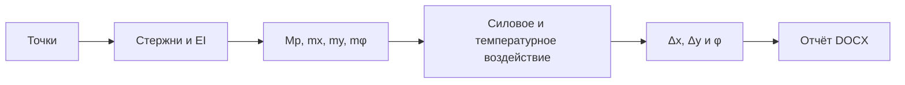

<div align="center">

# Mohr Frame

### Перемещения плоских стержневых рам методом Мора

Нативное настольное приложение на Rust: точки, стержни и эпюры редактируются в одном окне, а результаты пересчитываются сразу.

[](https://github.com/thetskerp/mohr-frame-calculator/actions/workflows/ci.yml)
[](https://github.com/thetskerp/mohr-frame-calculator/releases/latest)
[](https://www.rust-lang.org/)
[](LICENSE)

[](https://github.com/thetskerp/mohr-frame-calculator/releases/latest/download/Mohr-Frame-Windows-x64.zip)
[](https://github.com/thetskerp/mohr-frame-calculator/releases/latest/download/Mohr-Frame-macOS-universal.zip)

[Все версии и контрольные суммы](https://github.com/thetskerp/mohr-frame-calculator/releases)

</div>

> Проект находится в активной разработке. Силовые и температурные перемещения реализованы; кинематическое перемещение пока оставлено отдельной подготовленной вкладкой.

## Возможности

- построение рамы по точкам и стержням с автоматическим определением длины и ориентации;
- редактирование эпюр `M`, `N`, `Q`, грузовой эпюры `Mp` и единичных эпюр `mx`/`my`/`mφ`;
- расчёт горизонтального `Δx`, вертикального `Δy` перемещений и поворота `φ` выбранной точки;
- расчёт температурных перемещений по двум слагаемым с эпюрами `m` и `n`;
- температуры `t₁`/`t₂`, разность `t′`, средняя температура `t₀`, высота сечения `h` для каждого стержня;
- числовой или аналитический базовый коэффициент расширения `α`, а также множитель `kα` для каждого стержня (`αᵢ = kα·α`);
- индивидуальная жёсткость каждого стержня: `EI участка = k·EI`;
- постоянные, линейные и параболические эпюры;
- отображение эпюр на растянутых волокнах с явным выбором стороны ординаты;
- подробная подстановка по каждому стержню, включая нулевые слагаемые;
- несколько представлений результата: десятичное, обыкновенная дробь и дробь с общим знаменателем `EI`;
- схема с размерами, шрифтом OpenGost Type A и размерными засечками;
- масштабирование и перемещение рамы мышью, отдельный масштаб ординат каждой эпюры;
- сохранение каждого проекта в отдельной папке с переносимым файлом `*.mohr.ron`;
- автоматическое открытие проектов v0.5.0/v0.5.1 и явный экспорт совместимой копии для v0.5.0;
- экспорт подробного отчёта Microsoft Word `*.docx`;
- мгновенное обновление схемы и результатов при изменении исходных данных.



## Установка

### Windows 10/11, x64

1. Скачайте [`Mohr-Frame-Windows-x64.zip`](https://github.com/thetskerp/mohr-frame-calculator/releases/latest/download/Mohr-Frame-Windows-x64.zip).
2. Распакуйте архив в обычную папку.
3. Запустите `Mohr Frame.exe`.

Установка Rust не требуется. Приложение пока не подписано коммерческим сертификатом, поэтому при первом запуске Windows SmartScreen может попросить подтвердить открытие.

### macOS 11 и новее

1. Скачайте [`Mohr-Frame-macOS-universal.zip`](https://github.com/thetskerp/mohr-frame-calculator/releases/latest/download/Mohr-Frame-macOS-universal.zip).
2. Распакуйте архив и перенесите `Mohr Frame.app` в папку «Программы» или оставьте рядом с файлами проекта.
3. При первом запуске щёлкните приложение правой кнопкой мыши и выберите «Открыть».

Архив универсальный: одна сборка работает на Mac с Apple Silicon и Intel. Приложение подписано локальной ad-hoc подписью, но пока не нотарифицировано Apple, поэтому macOS может запросить дополнительное подтверждение.

## Быстрый старт

1. На вкладке **«Схема и эпюры M N Q»** создайте точки с координатами.
2. Добавьте стержни между выбранными точками. Длина вычислится по координатам.
3. Выберите точку, перемещения и поворот которой нужно найти.
4. Для каждого стержня задайте жёсткость и эпюры `Mp`, `mx`, `my`, `mφ`.
5. Откройте вкладку **«Силовые перемещения и поворот»** и проверьте результаты `Δx`, `Δy` и `φ`.
6. При температурном воздействии на вкладке **«Температурное перемещение»** задайте `α`, `h`, `t₁`, `t₂` и единичные эпюры `nx`/`ny`/`nφ`.
7. Отметьте виды воздействий, входящие в итог, сохраните схему или нажмите **«Экспорт Word»**.

### Управление холстом

- колесо мыши над любым холстом — масштаб всей рамы относительно курсора;
- перетаскивание левой кнопкой — перемещение всей рамы;
- `Shift` + колесо — изменение только высоты текущей эпюры;
- двойной щелчок левой кнопкой — сброс вида.

Камера общая для схемы и всех эпюр, поэтому их геометрия остаётся синхронной. Масштабы ординат `M`, `N`, `Q`, `mx`, `my`, `mφ`, `nx`, `ny` и `nφ` независимы.

В архив также включён файл `example-frame.mohr.ron` — готовый пример рамы для проверки интерфейса и расчёта.

## Система знаков

Все эпюры строятся **на растянутых волокнах**. Каждая ненулевая ордината вводится как модуль и сторона:

- верхние волокна горизонтального / левые волокна вертикального стержня — знак `−`;
- нижние волокна горизонтального / правые волокна вертикального стержня — знак `+`.

Для наклонного стержня «лево/право» понимается относительно локальной оси от начальной точки к конечной. Сторона выпуклости параболы задаёт знак добавки `qL²/8` к полусумме концевых ординат.

## Расчёт

Для двух линейных или постоянных эпюр используется точная аналитическая формула:

```text
L / 6 · [Ap · (2A1 + B1) + Bp · (A1 + 2B1)]
```

Если хотя бы одна эпюра параболическая, в текущей версии применяется заданная трёхточечная формула:

```text
L / 6 · (Mp,left · m1,left + 4 · Mp,mid · m1,mid + Mp,right · m1,right)
```

> Если обе перемножаемые эпюры параболические, их произведение имеет четвёртую степень, поэтому трёхточечная формула является принятой в текущей версии аппроксимацией. Альтернативный способ ручного перемножения криволинейных эпюр запланирован отдельно.

Температурное перемещение вычисляется отдельно:

```text
ΔT = α · Σ kα · [(t₂ − t₁) / h · ∫m ds + t₀ · ∫n ds]
t′ = |t₁ − t₂|,  t₀ = (t₁ + t₂) / 2
```

Площади единичных эпюр в температурном расчёте интегрируются аналитически. Более нагретая сторона задаёт знак температурного изгиба; для `n` принято растяжение со знаком `+`, сжатие — `−`.

## Формат проекта и файлы

Для каждого проекта создаётся отдельная папка с тем же именем. Например, проект `first_scheme` хранится в `first_scheme/first_scheme.mohr.ron`, а Word-отчёт — в `first_scheme/first_scheme-report.docx`. Расширение файла схемы фиксировано и не вводится пользователем.

Файл `*.mohr.ron` остаётся читаемым текстовым форматом. В нём находятся точки, стержни, коэффициенты жёсткости, эпюры, выбранная точка и вид холста. Всю папку проекта можно отправить другому пользователю и открыть на Windows или macOS.

Формат имеет независимую версию схемы. v0.6.0 автоматически открывает и мигрирует файлы v0.5.0 и v0.5.1. Для старых стержней принимаются `h = 0,5`, `kα = 1`, отсутствие температурного воздействия и нулевые единичные эпюры `n`. Для работы в v0.5.0 есть кнопка **«Экспорт v0.5.0»**; из такой копии исключаются неподдерживаемые данные новых версий.

При повторном сохранении предыдущий файл копируется в `backups/<имя>-previous.mohr.ron`, а новый файл записывается через временную копию.

По умолчанию папки проектов создаются рядом с приложением. Кнопка **«Очистить схему»** удаляет данные только с рабочего полотна и не стирает сохранённые файлы.

## Сборка из исходников

Понадобится [стабильный Rust toolchain](https://rustup.rs/).

```bash
git clone https://github.com/thetskerp/mohr-frame-calculator.git
cd mohr-frame-calculator
cargo run --release
```

Проверки проекта:

```bash
cargo fmt --all -- --check
cargo clippy --all-targets -- -D warnings
cargo test --locked
```

Нативная macOS-сборка в формате `.app`:

```bash
chmod +x scripts/bundle-macos.sh
./scripts/bundle-macos.sh
open "dist/Mohr Frame.app"
```

Windows:

```powershell
cargo build --release --locked
.\target\release\mohr-frame.exe
```

Релизные архивы автоматически собираются GitHub Actions при публикации тега вида `v0.6.0`.

## Структура

| Путь | Назначение |
|---|---|
| `src/lib.rs` | Расчётная модель: точки, стержни, эпюры и перемножение |
| `src/main.rs` | Окно приложения и редактор модели |
| `src/canvas.rs` | Интерактивный холст, камера и отрисовка эпюр |
| `src/project.rs` | Версионированный формат, миграции, резервные копии и экспорт v0.5.0 |
| `src/docx_report.rs` | Формирование подробного Word-отчёта |
| `examples/` | Переносимый пример проекта |
| `packaging/macos/` | Метаданные пакета `.app` |
| `.github/workflows/` | Проверка и выпуск сборок Windows/macOS |

## План развития

- альтернативное ручное перемножение криволинейных эпюр;
- кинематические перемещения;
- автоматическое построение эпюр по заданной схеме и нагрузкам;
- дальнейшее развитие оформления схем по требованиям СПДС/ГОСТ.

## Лицензии

Исходный код распространяется по лицензии [MIT](LICENSE).

Шрифт OpenGost Type A распространяется по SIL Open Font License 1.1. Текст лицензии находится в [`assets/OpenGost-LICENSE.txt`](assets/OpenGost-LICENSE.txt).
