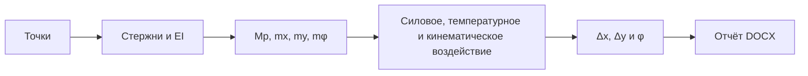

<div align="center">

# Mohr Frame

### Перемещения плоских стержневых рам методом Мора

Настольное приложение: расчётное ядро на Rust, интерфейс Qt Widgets на C++.

[](https://github.com/thetskerp/mohr-frame-calculator/actions/workflows/ci.yml)
[](https://github.com/thetskerp/mohr-frame-calculator/releases/latest)
[](https://www.rust-lang.org/)
[](LICENSE)

[](https://github.com/thetskerp/mohr-frame-calculator/releases/latest/download/Mohr-Frame-Windows-x64.zip)
[](https://github.com/thetskerp/mohr-frame-calculator/releases/latest/download/Mohr-Frame-macOS-universal.zip)

[Все версии и контрольные суммы](https://github.com/thetskerp/mohr-frame-calculator/releases)

</div>

> В исходниках готовится v0.9.0. Ссылки на архивы ведут к последней опубликованной версии, пока v0.9.0 не выпущена.

## Возможности

- построение рамы по точкам и стержням с автоматическим определением длины и ориентации;
- табличное задание точек и стержней с проверкой перед применением;
- импорт исходной модели из Excel `.xlsx` или набора CSV с предварительным просмотром;
- автоматические имена точек `A…Z, AA…` и стержней по их концам (`AB`, `AA-B`), с возможностью ручного переименования;
- проверка совпадающих координат точек, имён и повторного задания одного стержня в любом направлении;
- редактирование эпюр `M`, `N`, `Q`, грузовой эпюры `Mp` и единичных эпюр `mx`/`my`/`mφ`;
- расчёт горизонтального `Δx`, вертикального `Δy` перемещений и поворота `φ` выбранной точки;
- расчёт температурных перемещений по двум слагаемым с эпюрами `m` и `n`;
- расчёт кинематических перемещений опор по заданным смещениям и реакциям трёх единичных систем;
- температуры `t₁`/`t₂`, разность `t′`, средняя температура `t₀`, высота сечения `h` для каждого стержня;
- независимые таблицы жёсткостей `EI` и коэффициентов расширения `α` с назначением строк стержням;
- аналитическая строка задаёт коэффициент перед `EI` или `α`, числовая — мантиссу и степень десяти;
- постоянные, линейные и параболические эпюры;
- отображение эпюр на растянутых волокнах с явным выбором стороны ординаты;
- подробная подстановка по каждому стержню, включая нулевые слагаемые;
- несколько представлений результата: десятичное, обыкновенная дробь и дробь с общим знаменателем `EI`;
- схема с размерами, шрифтом OpenGost Type A и размерными засечками;
- масштабирование и перемещение рамы мышью, отдельный масштаб ординат каждой эпюры;
- сохранение каждого проекта в отдельной папке с переносимым файлом `*.mohr.ron`;
- нативный выбор файла проекта через Finder на macOS или Проводник Windows;
- автоматическое открытие проектов v0.5.0/v0.5.1 и явный экспорт совместимой копии для v0.5.0;
- экспорт подробного отчёта Microsoft Word `*.docx`;
- обновление схемы и результатов после применения исходных данных;
- вкладка МКЭ с узловыми нагрузками `Fₓ`, `Fᵧ`, `Mᶻ`, равномерными нагрузками `qₓ`, `qᵧ` и сосредоточенными силами и моментами на стержне; дерево объектов и свойства находятся в изменяемых по размеру панелях;
- четыре типа опор с условными обозначениями на схеме: жёсткая заделка, шарнирно неподвижная, шарнирно подвижная и скользящая заделка;
- расчёт опорных реакций и эпюр `M`, `N`, `Q` для грузовой и выбранных единичных систем `X`, `Y`, `φ`; визуализация направления реакций на схеме;
- внутренний шарнир в общей точке двух стержней: освободите момент на конце одного из них; продольное и поперечное усилия передаются, сдвиговые деформации не учитываются;
- нижняя панель с реакциями, формулами `N(x)`, `Q(x)`, `M(x)`, характерными сечениями и экстремумами; подробный узловой баланс включается в Word-отчёт МКЭ;
- пустые расчёты и незаданные направления перемещений не попадают в Word-отчёты;
- проверка геометрической неизменяемости после наложения опорных связей;
- передача единичных эпюр `M`, `N` и реакций опор в расчёт перемещений;
- отдельный Word-отчёт МКЭ с выбором разделов: геометрия, нагрузки, устойчивость, реакции, грузовые и единичные эпюры;
- настройки приложения: число знаков после запятой (по умолчанию 2) и направление стрелок реакций по глобальным осям либо по фактическому направлению; таблицы сохраняют знаковые проекции;
- учебный режим округления расчётных шагов, сохраняемый в проекте; матрица МКЭ и исходные коэффициенты рассчитываются с полной точностью.



## Установка

### Windows 10/11, x64

1. Скачайте [`Mohr-Frame-Windows-x64.zip`](https://github.com/thetskerp/mohr-frame-calculator/releases/latest/download/Mohr-Frame-Windows-x64.zip).
2. Распакуйте архив в обычную папку.
3. Запустите `Mohr Frame.exe`.

Установка Rust не требуется. Приложение пока не подписано коммерческим сертификатом, поэтому при первом запуске Windows SmartScreen может попросить подтвердить открытие.

### macOS 12 и новее для v0.9.0

1. Скачайте [`Mohr-Frame-macOS-universal.zip`](https://github.com/thetskerp/mohr-frame-calculator/releases/latest/download/Mohr-Frame-macOS-universal.zip).
2. Распакуйте архив и перенесите `Mohr Frame.app` в папку «Программы» или оставьте рядом с файлами проекта.
3. При первом запуске щёлкните приложение правой кнопкой мыши и выберите «Открыть».

Релизный workflow готовит универсальную сборку для Apple Silicon и Intel. Приложение подписывается локальной ad-hoc подписью, но не нотарифицируется Apple. Последний опубликованный релиз может поддерживать более старые версии macOS.

## Быстрый старт

1. Откройте **Редактирование → Табличное задание точек и стержней**. В одном окне задайте количество точек и стержней, заполните готовые строки и проверьте схему справа перед применением.
2. В дереве слева выберите точку. В панели справа задайте её опору, узловые силы и искомую точку. Для стержня там же задаются шарниры, `h`, температуры и нагрузки.
3. В меню **Редактирование** задайте отдельные таблицы `EI` и `α`. Значение `numeric=0` означает коэффициент перед символом, `numeric=1` — мантиссу × 10^степень.
4. Для ручного расчёта выберите стержень и откройте **Эпюра выбранного стержня**. Доступны грузовые `M/N/Q` и единичные `mX/mY/mφ`, `nX/nY/nφ`.
5. Для кинематического воздействия задайте смещения через **Редактирование → Смещения опор**. В **Файл → Настройки** находятся отдельные разделы оформления, расчёта и округления, МКЭ и отчёта. Там же выбираются системная, светлая или тёмная тема и цвета элементов схемы.
6. Сохраняйте схему через **Файл → Сохранить**. Программа создаёт отдельную папку проекта и сохраняет Word-отчёты в неё.

Команды работы с файлом, редактирования и расчёта находятся в верхних меню **Файл**, **Редактирование** и **Расчёт**. На вкладках **«Схема и эпюры»**, **«Силовое перемещение»** и **«Температурное перемещение»** над холстом есть подписанный список **«Эпюра на холсте»**: схема без эпюры, грузовые `M/N/Q` и единичные моменты и продольные силы для `X/Y/φ`. Выбор на каждой вкладке независим. На вкладке МКЭ над холстом отдельно указаны **«Расчётная система»** и **«Эпюра»**.

### Импорт Excel и CSV

Шаблон [`templates/mohr-input.xlsx`](templates/mohr-input.xlsx) и одноимённый набор [CSV-таблиц](templates/csv) задают одинаковые столбцы. Обязательны листы или файлы `Points` (`id,x,y`) и `Rods` (`id,start,end`). Остальные таблицы необязательны: `EI`, `Alpha`, `Settings`, `Supports`, `NodeLoads`, `MemberLoads`, `PointLoads`, `Diagrams`. Для CSV все файлы одной схемы должны лежать в одном каталоге и называться точно по именам таблиц. Импортирование других CSV в этом каталоге не влияет на модель.

Единицы пользователь выбирает согласованно: координаты и `h` в длине; `Fx,Fy` в силе; `Mz` в силе·длине; `qx,qy` в силе/длине; температуры в °C. В учебном примере можно применять м, кН и кН·м. Автоматического перевода единиц нет. Десятичная запятая читается как точка; в CSV с запятой-разделителем такое число заключайте в кавычки либо используйте точку. Пустые необязательные поля получают документированные значения по умолчанию, обязательные вызывают ошибку. Формулы Excel должны иметь сохранённое вычисленное значение. Неподтверждённый или ошибочный импорт не изменяет открытый проект.

### Расчёт рамы МКЭ

Вкладка **«Расчёт рамы МКЭ»** использует точки и стержни текущего проекта. Выберите объект на схеме либо в дереве. Свойства точки или стержня редактируются в правой панели. Для узла доступны опора и нагрузки `Fₓ`, `Fᵧ`, `Mᶻ`. Для стержня — распределённые `qₓ`, `qᵧ` по всей длине, сосредоточенные нагрузки с положением `x/L` и необязательные численные `EA`, `EI`. Проекции нагрузок вводятся в глобальных осях. Для статически определимой рамы `EA=EI=0` выбирает аналитический режим; для статически неопределимой рамы нужны численные `EA` и `EI` на каждом стержне.

В **Файл → Настройки → МКЭ** отметьте единичные системы `X=1`, `Y=1`, `Mᶻ=1` для искомой точки. Запустите **Расчёт → Рассчитать МКЭ** или кнопку на вкладке МКЭ. Два подписанных списка над холстом выбирают грузовую или единичную систему и эпюру `M/N/Q`; нижняя панель показывает реакции и подробные функции усилий. Решение выполняется в рабочем потоке. При вырожденной матрице расчёт останавливается с сообщением о механизме или зависимых связях.

Кнопка **«Передать эпюры и реакции»** заполняет грузовую и три единичные эпюры существующего расчёта и реакции опор. При расчёте без численных жёсткостей аналитическое `EI` основного проекта сохраняется; при расчёте с численными жёсткостями передаётся заданное `EI`. Для передачи должны быть рассчитаны все три единичные системы. Если внутри стержня задана сосредоточенная нагрузка, МКЭ рассчитывает и показывает её эпюры, но передача пока недоступна: нынешний формат ручной эпюры хранит только одну функцию на стержень и не представляет внутренний скачок. Ручные эпюры не меняются до явного нажатия кнопки передачи.

Элемент МКЭ — линейный плоский стержень Эйлера — Бернулли с тремя степенями свободы в узле (`uₓ`, `uᵧ`, `φ`). Деформации сдвига в этом модуле не учитываются. Единицы измерения должны быть согласованы пользователем. Исходные данные МКЭ сохраняются в файле проекта; результаты пересчитываются по запросу.

### Управление холстом

- колесо мыши над любым холстом — масштаб всей рамы относительно курсора;
- перетаскивание левой кнопкой — перемещение всей рамы;
- `Shift` + колесо — изменение только высоты текущей эпюры;
- двойной щелчок левой кнопкой — сброс вида.

Панели можно передвигать, скрывать и менять их размер. Их состояние и положение холстов сохраняются в настройках приложения. Масштаб ординат запоминается отдельно для каждой выбранной эпюры.

В архив также включён файл `example-frame.mohr.ron` — готовый пример рамы для проверки интерфейса и расчёта.

## Система знаков

Все эпюры строятся **на растянутых волокнах**. Каждая ненулевая ордината вводится как модуль и сторона:

- верхние волокна горизонтального / левые волокна вертикального стержня — знак `−`;
- нижние волокна горизонтального / правые волокна вертикального стержня — знак `+`.

Для наклонного стержня «лево/право» понимается относительно локальной оси от начальной точки к конечной. Сторона выпуклости параболы задаёт знак добавки `qL²/8` к полусумме концевых ординат.

## Расчёт

Для двух линейных или постоянных эпюр используется точная аналитическая формула:

```text
L / 6 · [Ap · (2A1 + B1) + Bp · (A1 + 2B1)]
```

Если хотя бы одна эпюра параболическая, в текущей версии применяется заданная трёхточечная формула:

```text
L / 6 · (Mp,left · m1,left + 4 · Mp,mid · m1,mid + Mp,right · m1,right)
```

> Если обе перемножаемые эпюры параболические, их произведение имеет четвёртую степень, поэтому трёхточечная формула является принятой в текущей версии аппроксимацией. Альтернативный способ ручного перемножения криволинейных эпюр запланирован отдельно.

Температурное перемещение вычисляется отдельно:

```text
ΔT = Σ αᵢ · [sₜ · t′ / h · ∫m ds + t₀ · ∫n ds]
t′ = |t₁ − t₂|,  t₀ = (t₁ + t₂) / 2
```

Здесь `t′` всегда неотрицательно, а `sₜ` задаётся стороной наиболее нагретых волокон: верх/лево — `−1`, низ/право — `+1`. Площади единичных эпюр интегрируются аналитически. Для `n` принято растяжение со знаком `+`, сжатие — `−`.

Кинематическое перемещение для каждой искомой компоненты определяется по заданным смещениям опорных связей `cᵢ` и реакциям `Rᵢ⁽¹⁾` в соответствующей единичной системе:

```text
ΔK = −Σ Rᵢ⁽¹⁾ · cᵢ
```

Положительные направления: `X` вправо, `Y` вверх, `φ` против часовой стрелки. На вкладке ручного кинематического расчёта реакции единичных систем можно ввести вручную. Модуль МКЭ вычисляет их автоматически и передаёт по кнопке «Передать эпюры и реакции», сохраняя ранее введённые смещения совпадающих опор. Для наклонной подвижной опоры реакция проецируется на её нормаль. В расчёте и отчёте сохраняются также нулевые слагаемые.

Для одной точки можно задать несколько смещений опор по направлениям `X`, `Y`, `φ`, а для наклонной связи — по нормали. Каждое направление сохраняется отдельной строкой.

## Формат проекта и файлы

Для каждого проекта создаётся отдельная папка с тем же именем. Например, проект `first_scheme` хранится в `first_scheme/first_scheme.mohr.ron`, отчёт по перемещениям — в `first_scheme/first_scheme-report.docx`, а отчёт МКЭ — в `first_scheme/first_scheme-fem-report.docx`. Расширение файла схемы фиксировано и не вводится пользователем.

Файл `*.mohr.ron` остаётся читаемым текстовым форматом. В нём находятся точки, стержни, таблицы `EI` и `α`, эпюры, исходные данные МКЭ, заданные смещения опор и выбранная точка. Поле вида прежнего холста сохранено для совместимости; размеры панелей и вид холстов Qt хранятся в настройках приложения на данном компьютере. Всю папку проекта можно отправить другому пользователю и открыть на Windows или macOS.

Кнопка **«Открыть…»** вызывает системное окно выбора файла. Если `*.mohr.ron` выбран в произвольном месте, его родительская папка считается папкой проекта: последующее сохранение схемы, резервная копия, Word-отчёт и совместимый экспорт остаются в этой папке.

Формат имеет независимую версию схемы: переход на Qt не меняет её номер (8). v0.9.0 открывает файлы v0.5.0–v0.8.2: прежние значения `k·EI` и `kα·α` преобразуются в строки новых таблиц, а отсутствующие признаки шарниров означают жёсткое соединение. В проектах старых версий отсутствующие смещения опор считаются нулевыми, а для старых стержней принимаются `h = 0,5`, отсутствие температурного воздействия и нулевые единичные эпюры `n`. Отсутствующая настройка расчётного округления означает полную точность. Экспорт в v0.5.0 сохраняет жёсткости, если все они аналитические либо все числовые; смесь этих типов старый формат представить не может. Температурные, кинематические данные и внутренние шарниры в v0.5.0 не входят.

Если старый файл содержит ранее допустимые совпадающие координаты точек или одинаковую геометрию стержней с разными именами, он открывается для исправления с предупреждением. Расчёт и сохранение становятся доступны после устранения конфликта; точки автоматически не объединяются.

При повторном сохранении предыдущий файл копируется в `backups/<имя>-previous.mohr.ron`, а новый файл записывается через временную копию.

При первом сохранении пользователь выбирает родительский каталог и название без расширения. Команда **Файл → Новый** очищает текущее рабочее окно и не стирает файлы на диске.

## Сборка из исходников

Понадобятся [стабильный Rust toolchain](https://rustup.rs/), CMake 3.24+, компилятор C++17 и Qt Widgets 6.8.x. На Windows используйте Qt для MSVC 2022 x64 и соответствующий компилятор; на macOS — Qt для macOS. Укажите папку установленного Qt через `CMAKE_PREFIX_PATH`.

```bash
git clone https://github.com/thetskerp/mohr-frame-calculator.git
cd mohr-frame-calculator
cmake -S . -B build/qt -DCMAKE_PREFIX_PATH=/путь/к/Qt/6.8.3/macos -DCMAKE_BUILD_TYPE=Release -DCMAKE_OSX_DEPLOYMENT_TARGET=12.0
cmake --build build/qt --parallel 4
open "build/qt/Mohr Frame.app"
```

Проверки проекта:

```bash
cargo fmt --all -- --check
cargo clippy --all-targets -- -D warnings
cargo test --locked
```

Простой замер МКЭ для консольных рам на 4, 20 и 60 стержней:

```bash
cargo run --release --locked --no-default-features --example benchmark_sizes
```

После расчёта МКЭ строка состояния Qt отдельно показывает время решения Rust, подготовки данных для сцены и её обновления. Перемещение и масштабирование холста не вызывают повторного расчёта МКЭ.

Отдельные проверки расчётного ядра:

```bash
cargo test --locked
```

Windows:

```powershell
cmake -S . -B build/qt -DCMAKE_PREFIX_PATH="C:/Qt/6.8.3/msvc2022_64" -DRUST_PROFILE=release
cmake --build build/qt --config Release --parallel 4
.\build\qt\Release\Mohr Frame.exe
```

Word-отчёт формируется только по отмеченным воздействиям. Расчётные разделы и параметры отключённого воздействия исключаются; итог суммирует только выбранные составляющие.

Локальная сборка требует Qt в системе разработчика. В релизном архиве Qt поставляется рядом с приложением: `windeployqt` на Windows и `macdeployqt` на macOS. Пользователю Rust и Qt устанавливать не нужно. Workflow выпуска запускается после публикации тега вида `v0.9.0`; сама публикация новой версии выполняется отдельно.

## Структура

| Путь | Назначение |
|---|---|
| `src/lib.rs` | Расчётная модель: точки, стержни, эпюры и перемножение |
| `src/fem.rs` | Расчёт МКЭ, опоры, реакции, эпюры и единичные системы |
| `src/bridge.rs` | Типизированные команды и DTO на границе Rust/C++ |
| `src/import.rs` | Импорт Excel/CSV, проверка ячеек и построение модели |
| `qt/` | Интерфейс Qt Widgets, панели, холсты и общий редактор геометрии |
| `src/main.rs`, `src/fem_window.rs`, `src/table_editor.rs`, `src/property_editor.rs`, `src/canvas.rs` | Прежний интерфейс egui под функцией сборки `legacy-egui`, временно сохранённый для проверки и сравнения |
| `src/view_state.rs` | Независимое состояние камеры, используемое прежним холстом |
| `src/project.rs` | Версионированный формат, миграции, резервные копии и экспорт v0.5.0 |
| `src/docx_report.rs` | Формирование подробного Word-отчёта |
| `templates/` | Шаблоны Excel/CSV и описание полей |
| `examples/` | Переносимый пример проекта |
| `packaging/` | Метаданные `.app`, лицензия LGPL и сведения о Qt |
| `.github/workflows/` | Проверка и выпуск сборок Windows/macOS |

## План развития

- альтернативное ручное перемножение криволинейных эпюр;
- автоматическое построение эпюр по заданной схеме и нагрузкам;
- дальнейшее развитие оформления схем по требованиям СПДС/ГОСТ.

## Известные ограничения

- Трёхточечное перемножение двух параболических эпюр остаётся принятой аппроксимацией, как в v0.8.2.
- Для статически неопределимой рамы МКЭ требует численные `EA` и `EI` каждого стержня. У статически определимой рамы усилия рассчитываются без их задания.
- Эпюры МКЭ со скачком от сосредоточенного воздействия внутри стержня видны в модуле МКЭ, но пока не передаются в ручной метод Мора: формат ручной эпюры хранит одну функцию на стержень.
- МКЭ использует элемент Эйлера — Бернулли; деформации сдвига в нём не учитываются. Метод сил для статически неопределимых рам в v0.9.0 не добавляется.
- Qt хранит положение панелей и масштаб локально на компьютере, поэтому они не переносятся вместе с файлом проекта.

## Лицензии

Исходный код распространяется по лицензии [MIT](LICENSE).

Интерфейс динамически связывается с Qt Core/Gui/Widgets. Их лицензия LGPLv3 и уведомление находятся в [`packaging/`](packaging/NOTICE-QT.md); соответствующие файлы входят в архивы приложения.

Шрифт OpenGost Type A распространяется по SIL Open Font License 1.1. Текст лицензии находится в [`assets/OpenGost-LICENSE.txt`](assets/OpenGost-LICENSE.txt).
